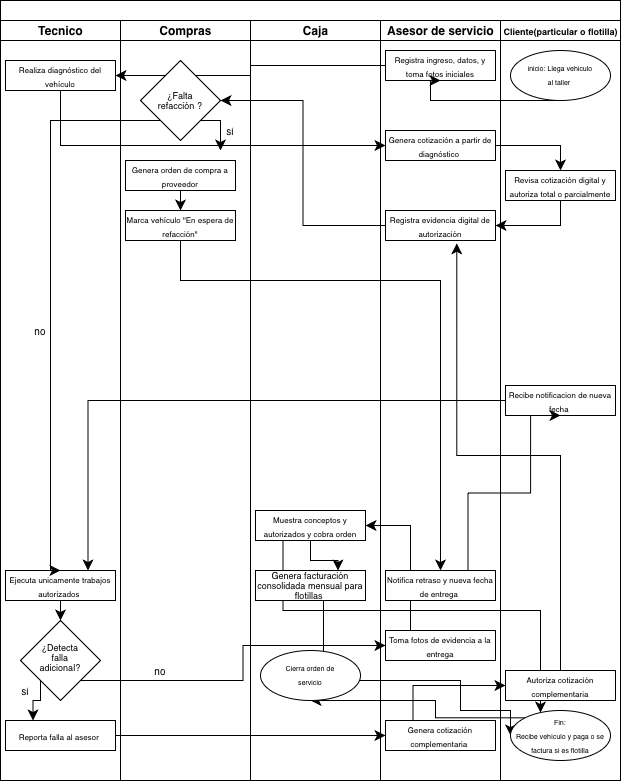
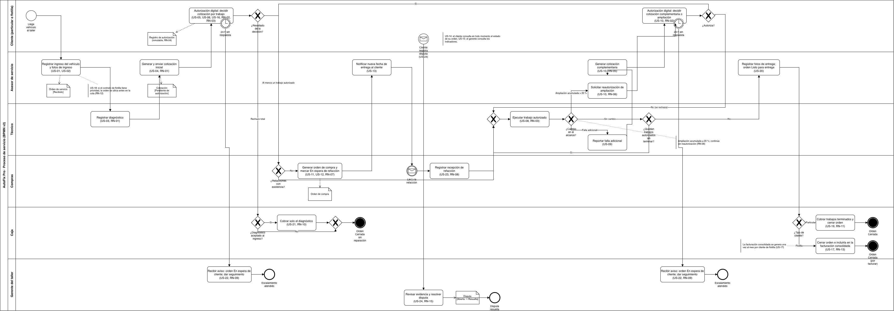
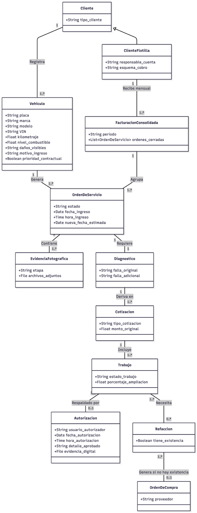
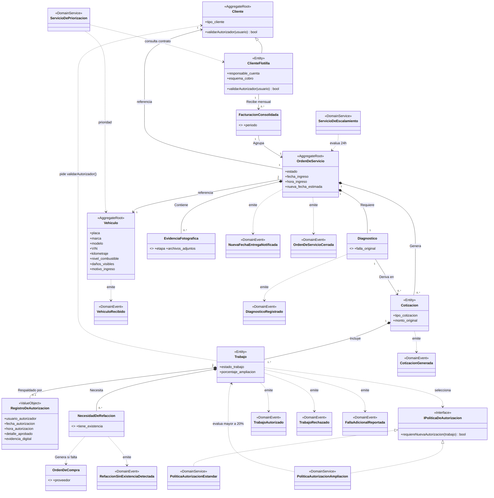
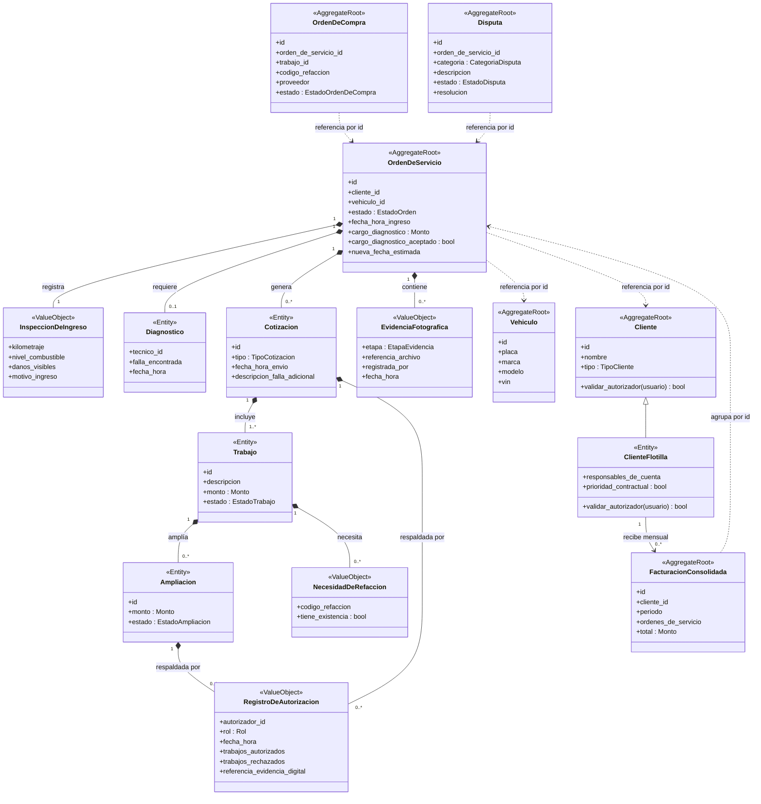
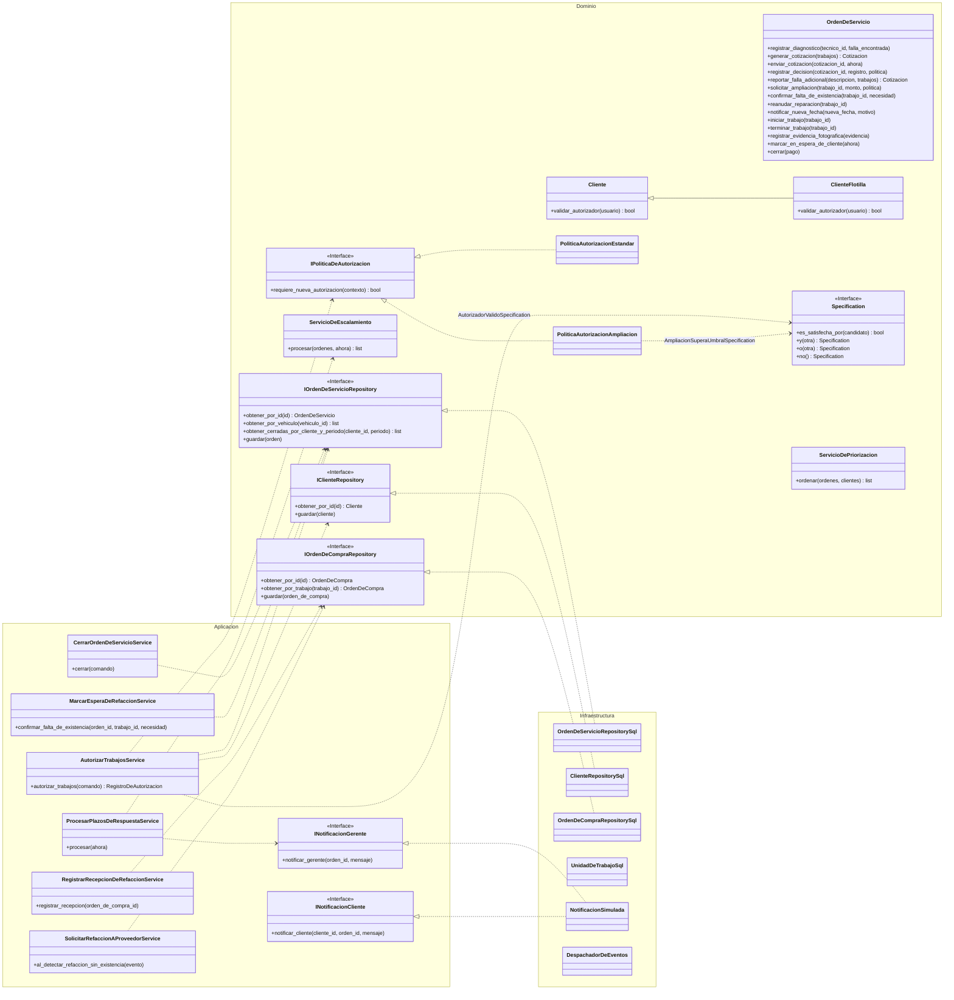
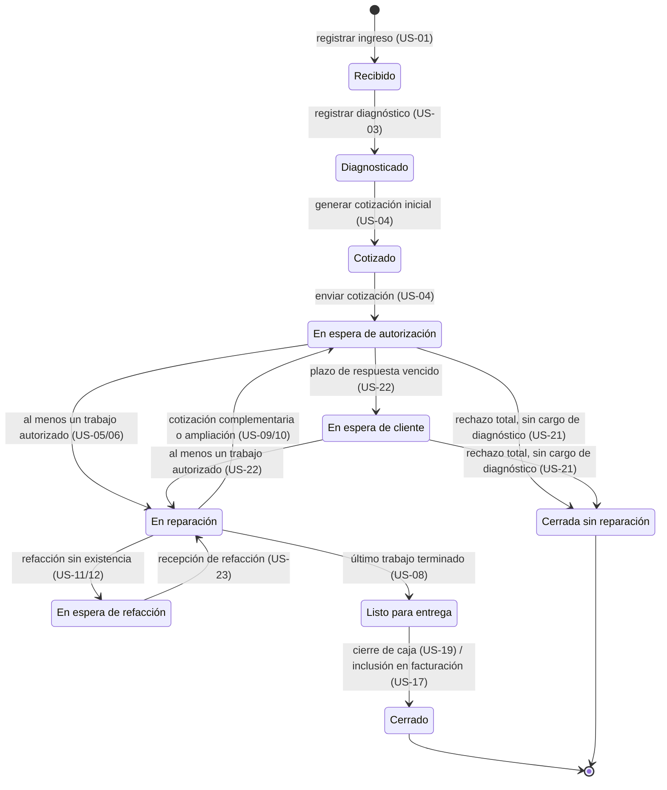
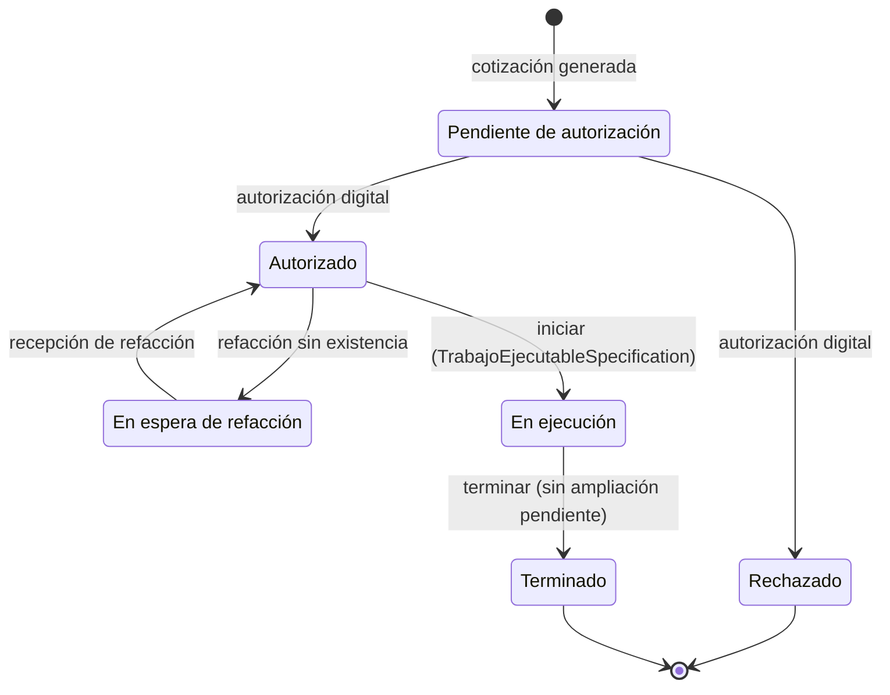

# Cambios respecto a la Unidad 2 y la Unidad 3

**Equipo 6 · Componentes de Lógica de Negocio · PIA**

Este documento reúne en un solo lugar qué se encontró al revisar los entregables de la Unidad 2 y la Unidad 3, qué se decidió, qué se corrigió o agregó y en qué documento vigente quedó. Los originales se conservan sin cambios en [`docs/antecedentes/`](antecedentes/).

**Versiones vigentes:** [BRD](BRD.md) · [BPMN v2](bpmn/BPMN_AutoFixPro_v2.drawio) · [Arquitectura](architecture/Arquitectura.md) · [ADRs](architecture/ADRs.md) · [Trazabilidad](architecture/Trazabilidad.md)

---

## 1. Antecedentes conservados

| Unidad | Archivo | Contenido |
|---|---|---|
| U2 | [U2_BRD_y_Modelo_de_Dominio.pdf](antecedentes/unidad-2/U2_BRD_y_Modelo_de_Dominio.pdf) | Levantamiento (19 preguntas), BRD, 20 historias, criterios de aceptación, BPMN, modelo de dominio, glosario y trazabilidad (04/09/2026) |
| U2 | [U2_BPMN_AutoFixPro.drawio](antecedentes/unidad-2/U2_BPMN_AutoFixPro.drawio) · [U2_BPMN.png](antecedentes/unidad-2/U2_BPMN.png) | BPMN original |
| U2 | [U2_Diagrama_UML.png](antecedentes/unidad-2/U2_Diagrama_UML.png) | Diagrama UML del modelo de dominio |
| U2 | [Caso_06_AutoFix_Pro_enunciado.docx](antecedentes/unidad-2/Caso_06_AutoFix_Pro_enunciado.docx) | Enunciado del caso entregado por el profesor |
| U3 | [U3_InformeDeArquitectura.pdf](antecedentes/unidad-3/docs/U3_InformeDeArquitectura.pdf) | Informe completo de diseño arquitectural (17/10/2026) |
| U3 | [U3_InformeDeArquitecturaRESUMEN.pdf](antecedentes/unidad-3/docs/U3_InformeDeArquitecturaRESUMEN.pdf), [U3_ADR.pdf](antecedentes/unidad-3/docs/U3_ADR.pdf), [U3_Trazabilidad.pdf](antecedentes/unidad-3/docs/U3_Trazabilidad.pdf), [U3_BitacoraIA.pdf](antecedentes/unidad-3/docs/U3_BitacoraIA.pdf) | Extractos del informe |
| U3 | [U3_01_mapa_dominio](antecedentes/unidad-3/diagramas/U3_01_mapa_dominio.png), [U3_02_diagrama_de_clases](antecedentes/unidad-3/diagramas/U3_02_diagrama_de_clases.png), [U3_03_secuencia_flujo_normal](antecedentes/unidad-3/diagramas/U3_03_secuencia_flujo_normal.png), [U3_04_secuencia_flujo_excepcion](antecedentes/unidad-3/diagramas/U3_04_secuencia_flujo_excepcion.png) | Diagramas (PNG y fuente Mermaid `.mmd`) |

El código React/JS de la U3 no se conserva en el repositorio: la implementación del PIA es en Python (ADR-007).

## 2. Resumen de cambios por artefacto

| Artefacto | Unidad 2 / Unidad 3 | PIA | Dónde |
|---|---|---|---|
| BRD | Sin tabla de reglas; 4 criterios de éxito, uno sin origen | 16 reglas de negocio con origen; 3 criterios medibles; alcance y restricciones actualizados | [BRD.md](BRD.md) §3–§7 |
| Historias | 20 historias, criterios casi solo del camino feliz | 24 historias (US-21 a US-24 nuevas) con Gherkin `Característica/Escenario` y escenarios de error | [BRD.md](BRD.md) §9 |
| Estados | Lista de 8 (US-14) o 9 (modelo) estados sin transiciones | Máquinas de estado de la orden (10 estados) y del trabajo (6) con transiciones | [BRD.md](BRD.md) §8, [Arquitectura.md](architecture/Arquitectura.md) §5 |
| Glosario | 20 términos | 38 términos; nombres unificados con el código | [BRD.md](BRD.md) §10 |
| BPMN | 5 carriles, sin temporizador ni rechazo total | 6 carriles, temporizadores, rechazo total, refacciones, ampliación, flotilla y disputas | Sección 5 |
| Modelo de dominio | U2: 11 clases; U3: 5 Aggregates | 6 Aggregates, Value Objects y Entities corregidos | Sección 6 |
| UML | Clases y 2 secuencias (U3) | Clases por capa, 4 secuencias con rutas de error | Sección 7 |
| Patrones | Domain Model, Service Layer, Repository, UoW, CQRS, Strategy, eventos | Se conservan y se agregan Specification, State Machine, API REST e interfaz web | [Arquitectura.md](architecture/Arquitectura.md) §2 |
| ADRs | ADR-001 a ADR-004 | Se conservan con notas de actualización; ADR-005 a ADR-014 nuevos | Sección 9 |
| Trazabilidad | BN → US (US-19 faltaba) | Historia → regla → BPMN → dominio → caso de uso → API → prueba | [Trazabilidad.md](architecture/Trazabilidad.md) |
| Implementación | React/JS sin API ni base de datos | Python, FastAPI, PostgreSQL, pruebas, Docker, CI/CD y despliegue | [README.md](../README.md) |

## 3. Hallazgos de la revisión y cómo se resolvieron

Los hallazgos H1 a H4 los detectó la propia U3 (Informe §1); los demás salieron de la revisión de coherencia del PIA.

| # | Hallazgo | Origen | Resolución | Dónde |
|---|---|---|---|---|
| H1 | El Gerente del Taller es stakeholder y aparece en US-15, pero no tenía carril en el BPMN | U3 §1-1 | Carril propio con escalamiento de 24 h y resolución de disputas | BPMN v2 |
| H2 | No había política para vehículos no recogidos (custodia) | U3 §1-2, P14 | Fuera de alcance (D9) | BRD §3.2 |
| H3 | La conexión inestable no tenía decisión de persistencia | U3 §1-3 | La versión requiere conexión; sin modo offline (D9) | BRD §5 |
| H4 | US-10 mezclaba la falla adicional (P10) con el umbral del 20 % (P12) | U3 §1-4, §4.5-6 | RN-05 (toda falla adicional requiere autorización) y RN-06 (umbral acumulado sobre la cotización inicial); escenarios separados en US-10 (D4) | BRD §7, §9 |
| R1 | El ciclo de vida no estaba definido: 8 estados en US-14, 9 en el modelo; U3 decía «8» y «9» en distintas secciones; no había transiciones | U2 US-14, U2 §6, U3 §3 y ADR-001 | Máquinas de estado de orden y trabajo (D1, D2) | BRD §8, Arquitectura §5 |
| R2 | El Trabajo no tenía estado «ejecutado», aunque US-19 cobra lo «autorizado y ejecutado» | U2 §6, U3 `estado_trabajo` | Estados `En ejecución` y `Terminado`; solo se cobra lo terminado (RN-11) | BRD §8.2 |
| R3 | El criterio de US-05/06 aceptaba autorizar «ninguno» sin decir qué ocurría | U2 §4 | Rechazo total y `Cerrada sin reparación` (D3, US-21) | BRD RN-10 |
| R4 | No existía la recepción de la refacción ni el regreso a reparación | U2 BPMN y US, U3 | US-23, RN-08, evento `RefaccionRecibida` (D6) | BRD, BPMN v2, Arquitectura |
| R5 | El escalamiento de 24 h no tenía historia, criterio ni temporizador | P13, glosario U2 (15), U3 `ServicioDeEscalamiento` | US-22, RN-09, temporizador en el BPMN y CU-06 (D5) | BRD, BPMN v2, ADR-013 |
| R6 | P12 compara contra la cotización; U3 evaluaba el 20 % por trabajo | P12, U3 diagrama de clases | Acumulado sobre el total autorizado de la cotización inicial (D4) | RN-06, ADR-004 |
| R7 | P15 decía «aprobación del asesor y del cliente»; US-05 y el BPMN muestran al cliente o al asesor registrando | P15, U2 BPMN | Solo autoriza el cliente titular o el responsable de cuenta; el asesor envía (D7) | RN-02 |
| R8 | US-15 pedía contar disputas, pero no había forma de registrarlas | U2 US-15 | Aggregate `Disputa` y US-24 (D8) | BRD, Arquitectura |
| R9 | El criterio de éxito 4 (encuestas de satisfacción) no salía del levantamiento | U2 §2.6 | Fuera de alcance (D8) | BRD §6 |
| R10 | La trazabilidad de U2 y U3 omitía US-19 y solo llegaba de necesidad a historia | U2 §8, U3 §12 | Matriz completa hasta pruebas | Trazabilidad.md |
| R11 | Multiplicidad contradictoria: 0..1 `RegistroDeAutorizacion` por trabajo en el diagrama, «varias» en el texto | U3 mapa vs. §4.5-2 | El registro se asocia a la cotización (0..*) | Arquitectura C2 |
| R12 | Interfaces de repositorio dentro de Infraestructura, contrario a la inversión de dependencias | U3 diagrama de clases | Interfaces en el dominio | Arquitectura C6 |
| R13 | Un Value Object (`NecesidadDeRefaccion`) emitía eventos y actuaba en la secuencia | U3 mapa y secuencia de excepción | Los eventos los emite el Aggregate Root | Arquitectura C4 |
| R14 | El diagrama de clases no incluía 5 servicios de la Service Layer ni `IClienteRepository`; las secuencias no tenían rutas de error | U3 §5, §10 | Diagrama por capas y 4 secuencias con `alt` | Arquitectura §8, §9 |
| R15 | La revisión de la Service Layer usaba ejemplos de otro dominio («confirmarPedido», «aprobarCredito», «Inventario insuficiente») | U3 §5.1 | Se reemplazó por los casos de uso reales del taller | Arquitectura §7 |
| R16 | El canal SMS/WhatsApp aparecía sin origen en la U2 | U3 `NotificacionSmsWhatsapp` | Notificación simulada detrás de interfaces (ADR-011) | Arquitectura C8 |
| R17 | Montos `Float` y «Orden requiere 1 Diagnóstico» aunque al ingresar aún no existe | U2 UML | `Monto` decimal y multiplicidad 0..1 | Arquitectura §3 |
| R18 | El PIA exige Specification, State Machine, API REST y decisiones técnicas que la U3 no tenía | Requisitos del PIA | ADR-005 a ADR-014 | ADRs.md |

## 4. Decisiones del caso (D1 a D10)

AutoFix Pro es ficticio; las decisiones se tomaron como supuestos del caso y se registran en [BRD.md §11](BRD.md).

| ID | Decisión | Resuelve |
|---|---|---|
| D1 | Estados de la orden, incluido `Cerrada sin reparación` | R1 |
| D2 | Estados del trabajo; solo `Terminado` se cobra | R2 |
| D3 | Rechazo total: no se repara y solo se cobra el diagnóstico aceptado | R3 |
| D4 | Umbral del 20 % acumulado sobre la cotización inicial; toda falla adicional requiere autorización | H4, R6 |
| D5 | Escalamiento a las 24 h al Gerente del Taller | H1, R5 |
| D6 | Recepción de la refacción y reanudación | R4 |
| D7 | Solo el cliente titular o el responsable de cuenta autoriza | R7 |
| D8 | Registro de disputas; encuestas fuera de alcance | R8, R9 |
| D9 | Custodia y operación sin conexión fuera de alcance | H2, H3 |
| D10 | Python, FastAPI, SQLAlchemy, PostgreSQL, Docker, GitHub Actions y Render | R18 |

Supuestos aceptados en la arquitectura (S1 a S4): ampliación rechazada, quién registra la ampliación, notificaciones sin reintento y estado tras el rechazo total con cargo. Ver [Arquitectura.md §12](architecture/Arquitectura.md).

## 5. BPMN: Unidad 2 → PIA

### 5.1 BPMN original (Unidad 2)

### 5.2 BPMN v2 (PIA)

Fuente editable: [`bpmn/BPMN_AutoFixPro_v2.drawio`](bpmn/BPMN_AutoFixPro_v2.drawio) (abrir en app.diagrams.net). La imagen `bpmn/BPMN_AutoFixPro_v2.png` la exporta el equipo desde diagrams.net.

### 5.3 Cambios

| BPMN de la U2 | BPMN v2 | Regla / historia |
|---|---|---|
| 5 carriles; sin Gerente del Taller | 6 carriles: Cliente, Asesor de servicio, Técnico, Compras, Caja y **Gerente del taller** | H1, US-22, US-24 |
| La decisión del cliente no tenía compuerta | Compuerta «¿Resultado de la decisión?»: al menos un trabajo autorizado / rechazo total | RN-03, US-05/06 |
| Sin ruta de rechazo total | «¿Diagnóstico aceptado al ingreso?» → cobrar solo el diagnóstico → **Orden Cerrada sin reparación** | RN-10, US-21 |
| Sin temporizador de 24 h | Dos temporizadores **no interruptores** (cotización inicial y complementaria) → aviso al Gerente | RN-09, US-22 |
| La compuerta «¿Falta refacción?» estaba antes de la cotización y no había regreso | Tras la autorización: «¿Refacciones con existencia?» → orden de compra → aviso de nueva fecha → **Llega la refacción** → recepción → regreso a la ejecución | RN-07, RN-08, US-11 a US-13, US-23 |
| La falla adicional iba directo a la cotización complementaria | «¿Cambio en el alcance?»: falla adicional / ampliación mayor al 20 % / sin cambio; decisión del cliente con compuerta propia | RN-05, RN-06, US-09, US-10 |
| Sin ciclo de ejecución | «¿Quedan trabajos autorizados sin terminar?» → repetir o pasar a Listo para entrega | D1, US-08 |
| Cobro y facturación sin distinguir tipo de cliente | Compuerta «¿Tipo de cliente?»: particular (cobrar y cerrar) / flotilla (cerrar e incluir en la facturación consolidada) | RN-11, RN-13, US-17, US-19 |
| Dos finales ambiguos («Cierra orden» y «Fin») | Un evento de fin con nombre por cada ruta | — |
| Eventos dibujados como elipses con texto; sin objetos de datos | Eventos, compuertas y objetos de datos BPMN: Orden de servicio, Cotización, Registro de autorización, Orden de compra, Disputa | — |
| — | Proceso de disputas (US-24) y anotaciones para US-14, US-15 y US-18 | RN-15 |

## 6. Modelo de dominio: Unidad 2 → Unidad 3 → PIA

### 6.1 Modelo de dominio de la Unidad 2

### 6.2 Mapa de dominio de la Unidad 3

### 6.3 Mapa de dominio del PIA

Copia de [Arquitectura.md §3](architecture/Arquitectura.md); ese documento es la versión vigente.

### 6.4 Cambios

| Concepto | Unidad 2 | Unidad 3 | PIA | Motivo |
|---|---|---|---|---|
| Datos del ingreso | Atributos de `Vehiculo` | Atributos de `Vehiculo` | Value Object `InspeccionDeIngreso` en cada orden | Cambian en cada ingreso (C1) |
| Prioridad contractual | Atributo de `Vehiculo` | `ServicioDePriorizacion` | Se conserva U3; atributo del contrato en `ClienteFlotilla` | Evita duplicar información del contrato |
| Falla adicional | Atributo de `Diagnostico` | Evento `FallaAdicionalReportada` | Se conserva U3; genera una cotización complementaria | Permite varias fallas |
| Refacción | Entity `Refaccion` | Value Object `NecesidadDeRefaccion` | Se conserva U3; ya no emite eventos | Los eventos los emite el Aggregate Root (C4) |
| Autorización | Clase `Autorizacion` 0..1 por trabajo | Value Object 0..1 por trabajo | `RegistroDeAutorizacion` 0..* por cotización | Una decisión cubre varios trabajos (C2) |
| Ampliación | `porcentaje_ampliacion` en `Trabajo` | Igual | Entity `Ampliacion` con estado y registro | RN-06 necesita conservar cada ampliación (C3) |
| Disputa | No existía | No existía | Aggregate `Disputa` | D8, US-24 (C5) |
| Montos | `Float` | Sin tipo | Value Object `Monto` (decimal) | Precisión de importes |
| Diagnóstico | 1 por orden | 1 por orden | 0..1 por orden | Una orden recién recibida aún no lo tiene |
| Aggregates | — | OrdenDeServicio, Vehiculo, Cliente/ClienteFlotilla, OrdenDeCompra, FacturacionConsolidada | Los 5 de U3 + Disputa | — |
| Eventos | — | 9 eventos | 23 eventos, incluidos RefaccionRecibida, PlazoDeRespuestaVencido, RechazoTotalRegistrado y OrdenCerradaSinReparacion | Nuevas rutas del BPMN |

## 7. UML: Unidad 3 → PIA

### 7.1 Diagrama de clases

Unidad 3: [U3_02_diagrama_de_clases.png](antecedentes/unidad-3/diagramas/U3_02_diagrama_de_clases.png). PIA (copia de [Arquitectura.md §8](architecture/Arquitectura.md)):

| Unidad 3 | PIA |
|---|---|
| Interfaces de repositorio en el *namespace* Infraestructura | En el dominio (C6) |
| 5 servicios de aplicación | Todos los servicios de los casos de uso, incluidos recepción de refacción y plazos de respuesta |
| `NotificacionSmsWhatsapp` | `NotificacionSimulada` con `INotificacionCliente` e `INotificacionGerente` (C8) |
| `requiereNuevaAutorizacionPorAmpliacion(trabajo)` (nombre distinto en el mapa) | `requiere_nueva_autorizacion(contexto)` usada por ambas políticas |
| Métodos en `camelCase` (JavaScript) | Métodos en `snake_case` (Python), mismos términos del glosario |
| Sin Specifications | `Specification` y sus 9 reglas |

### 7.2 Diagramas de secuencia

| Unidad 3 | PIA |
|---|---|
| [Flujo normal](antecedentes/unidad-3/diagramas/U3_03_secuencia_flujo_normal.png): el asesor invoca la autorización; el actor Cliente no interviene; no se obtiene el cliente del repositorio; sin ruta de error | §9.1: el Cliente Titular o Responsable de Cuenta decide; se obtiene el cliente con `IClienteRepository`; `alt` para autorizador no válido |
| [Flujo de excepción](antecedentes/unidad-3/diagramas/U3_04_secuencia_flujo_excepcion.png): el Value Object emite eventos; no hay recepción | §9.2: el Aggregate emite el evento; incluye la recepción de la refacción y la reanudación |
| — | §9.3 Rechazo total (nuevo) |
| — | §9.4 Plazo de respuesta vencido (nuevo) |

Los diagramas de secuencia del PIA están en [Arquitectura.md §9](architecture/Arquitectura.md).

## 8. Máquinas de estado (nuevas en el PIA)

Ni la U2 ni la U3 tenían transiciones definidas (R1). Copia de [Arquitectura.md §5](architecture/Arquitectura.md):

## 9. ADRs

| ADR | Unidad 3 | PIA |
|---|---|---|
| ADR-001 Domain Model | Aceptada | Se conserva; nota: ahora son 10 estados |
| ADR-002 Refacción en dos servicios | Aceptada; reconciliación pendiente | Se conserva; el evento lo emite el Aggregate; se extiende a la recepción; la reconciliación se resuelve en ADR-010 |
| ADR-003 Autorización polimórfica | Aceptada | Se conserva; `AutorizadorValidoSpecification` la envuelve |
| ADR-004 Política del 20 % | Aceptada; pendiente con el stakeholder | Se conserva; el pendiente se resuelve con D4 |
| ADR-005 a ADR-014 | — | Nuevos: Specification, State Machine, plataforma, API REST, persistencia, eventos, notificaciones, identidad, plazo programado e interfaz web |

## 10. Casos de uso y Service Layer

| Unidad 3 | PIA |
|---|---|
| CU-01 a CU-05 | Se conservan y se amplían con las historias que no tenían caso de uso |
| — | CU-06 Escalamiento por plazo de respuesta; CU-07 Disputas |
| `GestionDeIngresoService`, `DiagnosticoService` | `RegistrarIngresoService`, `RegistrarDiagnosticoService` (lenguaje ubicuo, C7) |
| — | `RegistrarRecepcionDeRefaccionService`, `ReanudarReparacionService`, `SolicitarReautorizacionDeAmpliacionService`, `EjecutarTrabajoService`, `RegistrarEvidenciaFotograficaService`, `ProcesarPlazosDeRespuestaService`, `RegistrarDisputaService`, `ResolverDisputaService` |

## 11. Historias, Gherkin y glosario

**Historias:** US-01 a US-20 conservan su número y propósito de la U2. Cambios:
- Los criterios usan `Característica`/`Escenario` y agregan escenarios de error (autorizador no válido, técnico que intenta autorizar, decisión ya registrada, orden ajena, fecha inválida, orden facturada dos veces).
- US-08 agrega inicio y terminación del trabajo y el paso a «Listo para entrega».
- US-10 separa la cotización complementaria y la ampliación mayor al 20 % en escenarios distintos (H4).
- US-16 registra el rol «Responsable de Cuenta».
- **Nuevas:** US-21 Rechazo total, US-22 Escalamiento por falta de respuesta, US-23 Recepción de refacción, US-24 Registro de disputas.

**Criterios de éxito:** CE-2 dice «menos de 2 horas», como en la respuesta P18, en lugar de «tiempo promedio de 2 horas». El criterio de satisfacción por encuestas queda fuera de alcance.

**Glosario (20 → 38 términos):**
- **Nuevos:** Diagnóstico, Trabajo, Ampliación, Registro de Autorización, Rechazo Total, Recepción de Refacción, Responsable de Cuenta, Prioridad Contractual, Listo para Entrega, Cerrada sin Reparación, Disputa, Cliente Titular, Evidencia Fotográfica, Necesidad de Refacción, Plazo de Respuesta, Cola de Atención, Compras, Caja, Gerente del Taller.
- **Unificados:** «Técnico Automotriz» → «Técnico»; «cotización original» → «Cotización Inicial»; «Responsable de flotilla» → «Responsable de Cuenta».
- **Redefinido:** «Inspección de Ingreso» ahora cubre kilometraje, combustible, daños y motivo; placa y VIN pertenecen al vehículo.

## 12. Implementación

La U3 se materializó en React/JS sin API, base de datos ni pruebas automatizadas de integración. El PIA implementa la arquitectura en Python (ADR-007), con:
- API REST documentada con OpenAPI (ADR-008);
- interfaz web orientada a la usabilidad (ADR-014);
- persistencia en PostgreSQL (ADR-009);
- 363 pruebas con 93.40 % de cobertura;
- Docker Compose, CI/CD en GitHub Actions y despliegue en Render.

Ver [README.md](../README.md) y [testing/Plan_de_pruebas.md](testing/Plan_de_pruebas.md).
