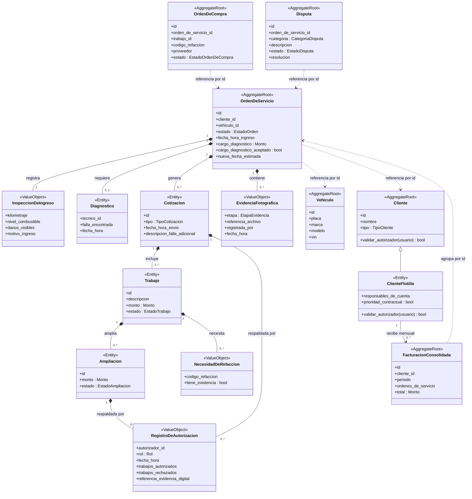
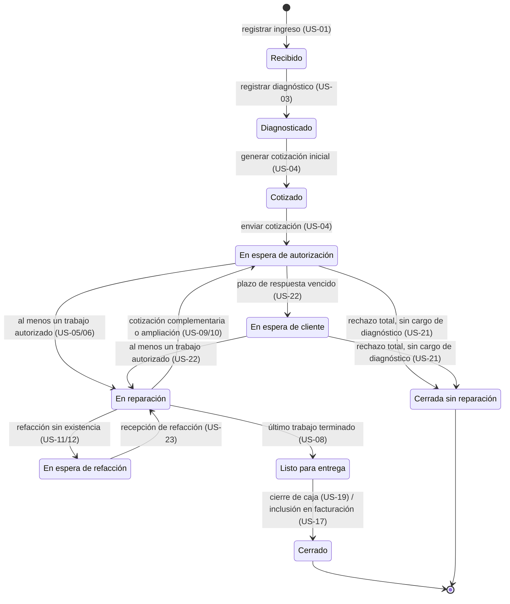
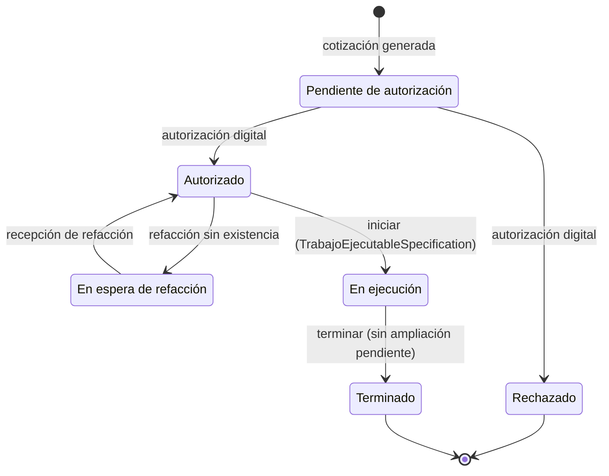
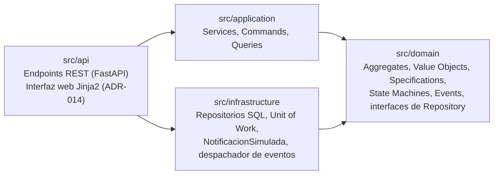
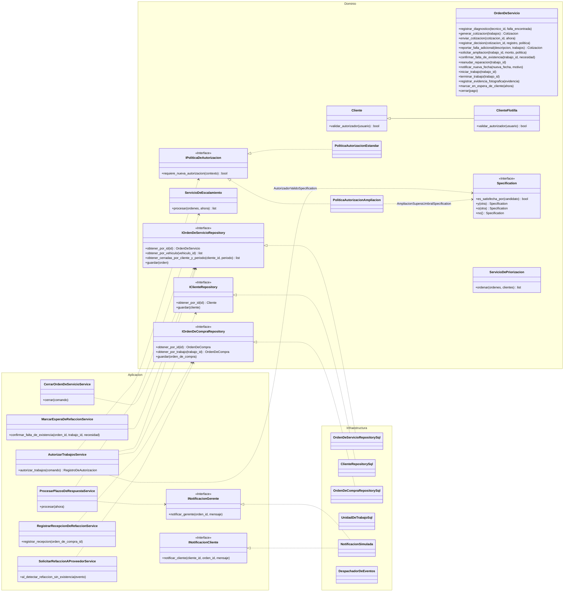
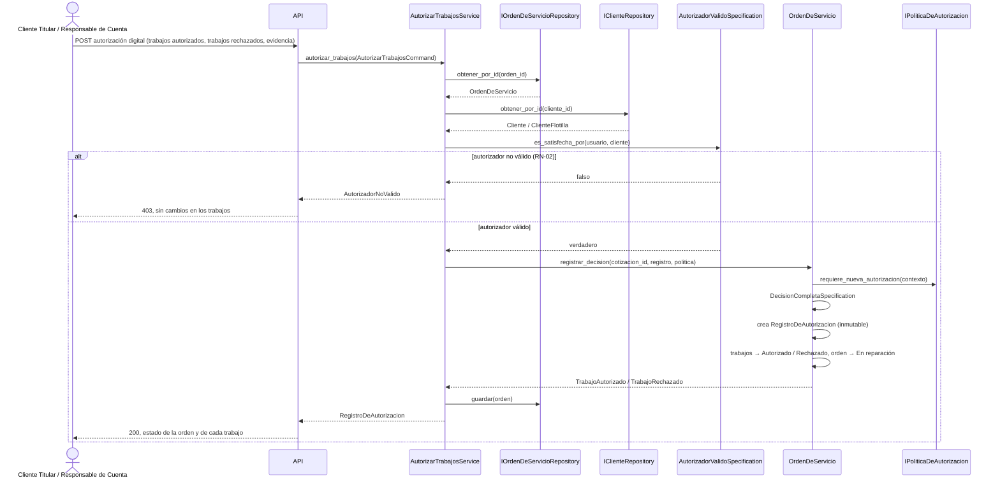
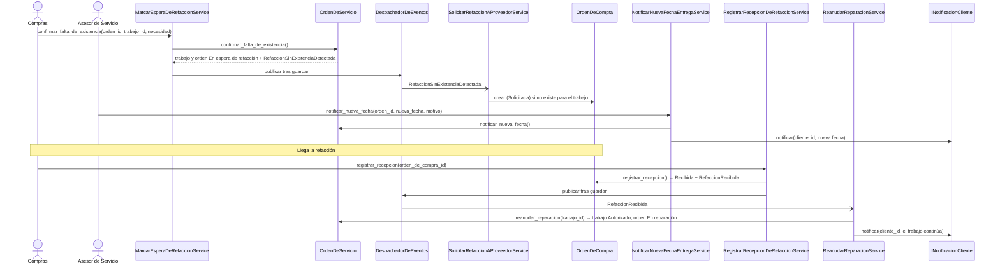
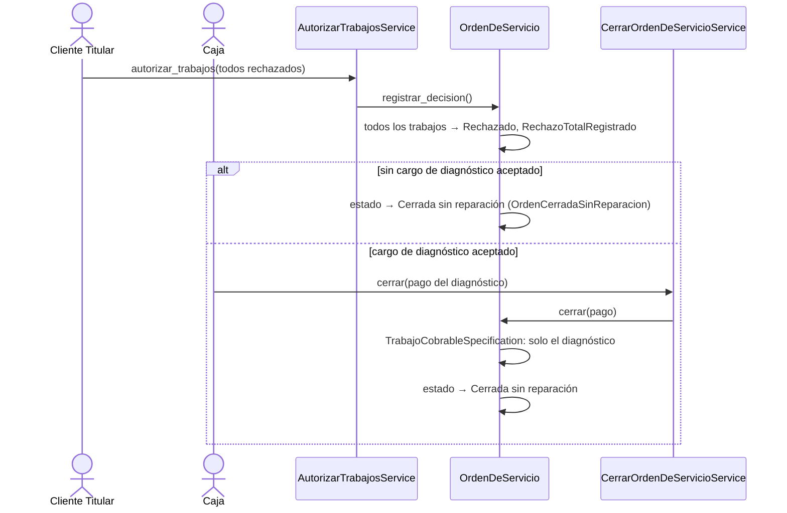
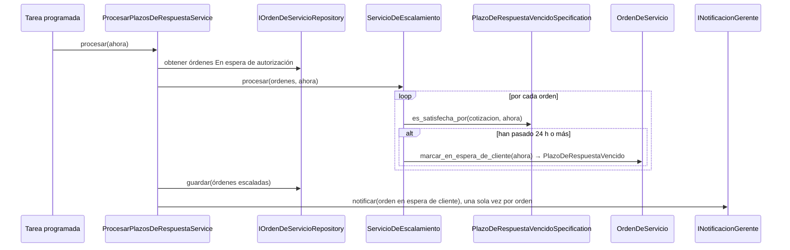

# Arquitectura — AutoFix Pro

**Equipo 6 · Componentes de Lógica de Negocio · PIA**

> **Origen.** Este documento refina el diseño de la Unidad 3 (`Unidad 3 AutoFixPro/docs/InformeDeArquitectura.pdf` y `diagrams/*.mmd`) y lo alinea con el BRD vigente (`docs/BRD.md`) y el BPMN v2 (`docs/bpmn/BPMN_AutoFixPro_v2.drawio`). Se conservan las decisiones aceptadas en la U3 (ADR-001 a ADR-004) y se agregan las piezas que exige el PIA: Specification, State Machine, API REST y decisiones técnicas (ADR-005 a ADR-013, en `ADRs.md`). Cada cambio respecto a la U3 está marcado con **[Cambio U3]** y su motivo.

---

## 1. Lenguaje ubicuo

### 1.1 Regla de nombres

1. Todo concepto del dominio usa **exactamente** el término del glosario del BRD (sección 10), en español.
2. En el código se escribe sin acentos ni espacios: clases en `PascalCase` (`OrdenDeServicio`), atributos y métodos en `snake_case` (`registrar_diagnostico`), constantes en `MAYUSCULAS`.
3. Los **valores visibles** de estados, roles y tipos se guardan con el texto literal del glosario (`"En espera de autorización"`), para que la API, la interfaz y los reportes muestren lo mismo que el BRD y el BPMN.
4. Solo los **sufijos de patrón** del curso van en inglés: `Service`, `Repository`, `Specification`, `Command`, `Query`, `Handler`. Se mantiene así la nomenclatura aceptada en la U3 (`AutorizarTrabajosService`, `IOrdenDeServicioRepository`).
5. Las rutas REST usan el término en plural y en minúsculas con guiones (`/ordenes-de-servicio`).

### 1.2 Correspondencia glosario → modelo → API

| Término del glosario | Elemento del modelo | Identificador en código | Recurso REST |
|---|---|---|---|
| Orden de Servicio | Aggregate Root | `OrdenDeServicio` | `/ordenes-de-servicio` |
| Inspección de Ingreso | Value Object | `InspeccionDeIngreso` | cuerpo de `POST /ordenes-de-servicio` |
| Diagnóstico | Entity | `Diagnostico` | `/ordenes-de-servicio/{id}/diagnostico` |
| Cotización Inicial / Cotización Complementaria | Entity | `Cotizacion` con `TipoCotizacion.INICIAL` / `COMPLEMENTARIA` | `/ordenes-de-servicio/{id}/cotizaciones` |
| Trabajo | Entity | `Trabajo` | `/ordenes-de-servicio/{id}/trabajos/{trabajo_id}` |
| Ampliación | Entity | `Ampliacion` | `/ordenes-de-servicio/{id}/trabajos/{trabajo_id}/ampliaciones` |
| Autorización Digital | Comando | `AutorizarTrabajosCommand` | `POST .../cotizaciones/{cotizacion_id}/autorizacion-digital` |
| Registro de Autorización | Value Object | `RegistroDeAutorizacion` | lectura en la cotización |
| Evidencia Digital | Atributo del registro | `referencia_evidencia_digital` | campo del cuerpo |
| Evidencia Fotográfica | Value Object | `EvidenciaFotografica` | `/ordenes-de-servicio/{id}/evidencias-fotograficas` |
| Falla Adicional | Evento + cotización complementaria | `FallaAdicionalReportada` | `/ordenes-de-servicio/{id}/fallas-adicionales` |
| Necesidad de Refacción | Value Object | `NecesidadDeRefaccion` | `.../trabajos/{trabajo_id}/necesidad-de-refaccion` |
| Refacción sin Existencia | Evento | `RefaccionSinExistenciaDetectada` | — |
| Orden de Compra | Aggregate Root | `OrdenDeCompra` | `/ordenes-de-compra` |
| Recepción de Refacción | Comando + evento | `RegistrarRecepcionDeRefaccionService`, `RefaccionRecibida` | `POST /ordenes-de-compra/{id}/recepcion-de-refaccion` |
| Cliente Particular / Cliente de Flotilla | Aggregate Root (jerarquía) | `Cliente` / `ClienteFlotilla` | `/clientes` |
| Cliente Titular / Responsable de Cuenta | Roles autorizadores | `Rol.CLIENTE_TITULAR` / `Rol.RESPONSABLE_DE_CUENTA` | identidad del usuario |
| Prioridad Contractual | Atributo del contrato + Domain Service | `ClienteFlotilla.prioridad_contractual`, `ServicioDePriorizacion` | — |
| Cola de Atención | Query | `ConsultarColaDeAtencionQuery` | `GET /cola-de-atencion` |
| Plazo de Respuesta | Specification + Domain Service | `PlazoDeRespuestaVencidoSpecification`, `ServicioDeEscalamiento` | `POST /plazos-de-respuesta/procesamiento` |
| En Espera de Cliente, En Espera de Refacción, Listo para Entrega, Cerrada sin Reparación | Estados | `EstadoOrden` | campo `estado` |
| Facturación Consolidada | Aggregate Root | `FacturacionConsolidada` | `/facturaciones-consolidadas` |
| Cierre de Caja | Application Service | `CerrarOrdenDeServicioService` | `POST /ordenes-de-servicio/{id}/cierre-de-caja` |
| Disputa | Aggregate Root | `Disputa` | `/disputas` |
| Tiempo de Comunicación de Retraso | Indicador | `tiempo_comunicacion_retraso` | `GET /indicadores` |
| Asesor de Servicio, Técnico, Compras, Caja, Gerente del Taller | Roles | `Rol.ASESOR_DE_SERVICIO`, `Rol.TECNICO`, `Rol.COMPRAS`, `Rol.CAJA`, `Rol.GERENTE_DEL_TALLER` | identidad del usuario |

### 1.3 Valores literales

| Enumeración | Valores (texto exacto del BRD) |
|---|---|
| `EstadoOrden` | Recibido · Diagnosticado · Cotizado · En espera de autorización · En espera de cliente · En reparación · En espera de refacción · Listo para entrega · Cerrado · Cerrada sin reparación |
| `EstadoTrabajo` | Pendiente de autorización · Autorizado · Rechazado · En espera de refacción · En ejecución · Terminado |
| `EstadoAmpliacion` | Pendiente de autorización · Autorizada · Rechazada |
| `EstadoOrdenDeCompra` | Solicitada · Recibida |
| `EstadoDisputa` | Abierta · Resuelta |
| `TipoCotizacion` | Inicial · Complementaria |
| `TipoCliente` | Particular · Flotilla |
| `EtapaEvidencia` | Ingreso · Entrega |
| `CategoriaDisputa` | Autorización · Cobro |
| `Rol` | Cliente Titular · Responsable de Cuenta · Asesor de Servicio · Técnico · Compras · Caja · Gerente del Taller |

### 1.4 Términos técnicos del modelo (no son del negocio)

| Término | Definición |
|---|---|
| Aggregate | Grupo de objetos con un límite de consistencia; solo se modifica a través de su raíz. |
| Aggregate Root | Objeto que controla el acceso y los cambios dentro de su Aggregate. |
| Entity | Objeto con identidad propia dentro de un Aggregate. |
| Value Object | Objeto sin identidad, definido por sus valores e inmutable. |
| Domain Service | Regla del dominio que no pertenece a una sola entidad. |
| Domain Event | Hecho de negocio ya ocurrido, comunicado a otros componentes. |
| Specification | Regla de negocio encapsulada que responde si un objeto la cumple; se puede combinar con otras. |
| Monto | Value Object de dinero en MXN con precisión decimal (nunca `float`). |

## 2. Patrones seleccionados

| Patrón | Dónde se aplica | Justificación | Origen |
|---|---|---|---|
| Domain Model | Todo el flujo de servicio | Hay 10 estados de orden, 6 de trabajo y reglas transversales (20%, 24 h, autorización parcial, flotillas) que deben vivir en un solo lugar. | ADR-001 (U3) |
| Table Module ligero | Indicadores (US-15) | Solo agrega datos ya existentes; no protege invariantes. | ADR-001 (U3) |
| Service Layer | `src/application` | Cada caso de uso coordina repositorios y dominio sin contener reglas. | U3 §5 |
| Repository | Un repositorio por Aggregate Root | El dominio no conoce SQL; las interfaces viven en el dominio. | U3 §6 |
| Unit of Work | Cada comando | Una transacción por Aggregate modificado. | U3 §7 |
| CQRS básico | Comandos y consultas separados | Las lecturas (estado, cobro, indicadores, cola) no pasan por el Aggregate completo. | U3 §8 |
| Strategy (Política) | `IPoliticaDeAutorizacion` | Reglas de autorización intercambiables sin modificar las existentes. | ADR-004 (U3) |
| Polimorfismo | `Cliente.validar_autorizador()` | Un solo servicio de autorización para particulares y flotillas. | ADR-003 (U3) |
| Domain Events | Coordinación entre Aggregates | Refacción sin existencia y recepción de refacción afectan a dos Aggregates. | ADR-002 (U3) |
| **Specification** | Reglas de negocio verificables | Reglas como RN-01, RN-02, RN-03, RN-06, RN-09, RN-11 y RN-13 se prueban sin base de datos y se combinan. | ADR-005 (nuevo) |
| **State Machine** | `EstadoOrden`, `EstadoTrabajo` | Las transiciones permitidas quedan en una tabla única; cualquier otra se rechaza. | ADR-006 (nuevo) |

## 3. Mapa de dominio

### 3.1 Fichas de Aggregate

| Aggregate Root | Responsabilidad | Invariantes | Eventos que emite |
|---|---|---|---|
| `OrdenDeServicio` | Ciclo de vida completo del servicio: ingreso, diagnóstico, cotizaciones, decisiones, ejecución, entrega y cierre. | RN-01 no hay cotización sin diagnóstico; RN-03 solo trabajos `Autorizado` se inician; RN-04 un registro de autorización no se modifica; RN-05 trabajos de cotización complementaria nacen `Pendiente de autorización`; RN-06 un trabajo con ampliación `Pendiente de autorización` no continúa; RN-10 rechazo total sin reparación; RN-11 solo `Terminado` es cobrable; RN-14 estados terminales; transiciones según la sección 5. | `VehiculoRecibido`, `DiagnosticoRegistrado`, `CotizacionGenerada`, `TrabajoAutorizado`, `TrabajoRechazado`, `RechazoTotalRegistrado`, `FallaAdicionalReportada`, `AmpliacionSolicitada`, `AmpliacionDecidida`, `RefaccionSinExistenciaDetectada`, `NuevaFechaEntregaNotificada`, `PlazoDeRespuestaVencido`, `ReparacionReanudada`, `EvidenciaFotograficaRegistrada`, `TrabajoIniciado`, `TrabajoTerminado`, `OrdenListaParaEntrega`, `OrdenDeServicioCerrada`, `OrdenCerradaSinReparacion` |
| `Vehiculo` | Identidad del vehículo independiente de sus órdenes; historial. | Placa y VIN no cambian una vez registrados. | — |
| `Cliente` / `ClienteFlotilla` | Distinguir reglas de autorización, facturación y prioridad. | RN-02: solo el cliente titular o un responsable de cuenta registrado autoriza; RN-12. | — |
| `OrdenDeCompra` | Solicitud de una refacción sin existencia al proveedor. | Solo se crea por `RefaccionSinExistenciaDetectada`; solo se recibe una vez (`Solicitada` → `Recibida`). | `RefaccionRecibida` |
| `FacturacionConsolidada` | Agrupar por cliente de flotilla y mes las órdenes `Cerrado`. | RN-13: solo órdenes `Cerrado` de ese cliente y periodo; una orden no aparece en dos facturaciones. | `FacturacionConsolidadaGenerada` |
| `Disputa` | Caso formal sobre una autorización o un cobro. | RN-15: categoría `Autorización` o `Cobro`; solo el gerente la resuelve; `Abierta` → `Resuelta`. | `DisputaRegistrada`, `DisputaResuelta` |

### 3.2 Domain Services

| Servicio | Regla | Origen |
|---|---|---|
| `IPoliticaDeAutorizacion` con `PoliticaAutorizacionEstandar` y `PoliticaAutorizacionAmpliacion` | Decide si una decisión o ampliación requiere autorización explícita (RN-05, RN-06). `PoliticaAutorizacionAmpliacion` usa `AmpliacionSuperaUmbralSpecification`. | ADR-004 (U3), D4 |
| `ServicioDeEscalamiento` | Detecta órdenes cuyo plazo de respuesta venció y las pasa a `En espera de cliente` (RN-09). | U3 §4.4, D5 |
| `ServicioDePriorizacion` | Ordena la cola de atención según prioridad contractual y fecha de ingreso (RN-12). | U3 §4.5-3 |

### 3.3 Domain Events

| Evento | Lo emite | Lo consume | Efecto |
|---|---|---|---|
| `RefaccionSinExistenciaDetectada` | `OrdenDeServicio` | `SolicitarRefaccionAProveedorService` | Crea la `OrdenDeCompra` (ADR-002). |
| `RefaccionRecibida` | `OrdenDeCompra` | `ReanudarReparacionService` | El trabajo vuelve a `Autorizado`; la orden a `En reparación` (RN-08) y emite `ReparacionReanudada`. |
| `PlazoDeRespuestaVencido` | `OrdenDeServicio` | Notificación al gerente | Aviso al Gerente del Taller (RN-09). |
| `NuevaFechaEntregaNotificada`, `CotizacionGenerada`, `RefaccionRecibida` | `OrdenDeServicio` / `OrdenDeCompra` | Notificación al cliente | Aviso al cliente (US-04, US-13, US-23). |
| `OrdenDeServicioCerrada` | `OrdenDeServicio` | Facturación consolidada | La orden de flotilla queda disponible para el periodo (US-17). |
| Resto de eventos | — | Historial de la orden e indicadores | Auditoría y US-15. |

### 3.4 Decisiones que corrigen el diseño de la U3

| # | Cambio | Motivo |
|---|---|---|
| C1 | Kilometraje, nivel de combustible, daños visibles y motivo de ingreso pasan de `Vehiculo` al Value Object `InspeccionDeIngreso` de cada orden. **[Cambio U3]** | Cambian en cada ingreso; el `Vehiculo` solo guarda datos que no cambian (glosario 30). |
| C2 | `RegistroDeAutorizacion` se asocia a la `Cotizacion` (0..*) y no a cada `Trabajo` (0..1). **[Cambio U3]** | Una decisión puede cubrir varios trabajos y una cotización puede recibir varias decisiones; resuelve la contradicción entre el mapa de la U3 (0..1) y su §4.5-2 ("varias"). |
| C3 | Se agrega la Entity `Ampliacion` dentro de `Trabajo`. **[Cambio U3]** | RN-06 necesita conservar cada ampliación, su monto acumulado y su autorización; un atributo `porcentaje_ampliacion` no lo permite. |
| C4 | `NecesidadDeRefaccion` ya no emite eventos; los emite la raíz `OrdenDeServicio`. **[Cambio U3]** | En DDD los eventos los emite el Aggregate Root, no un Value Object. |
| C5 | Se agrega el Aggregate `Disputa`. **[Cambio U3]** | D8: US-15 necesita contar disputas y US-24 registrarlas. |
| C6 | Las interfaces de repositorio pasan a la capa de dominio. **[Cambio U3]** | En el diagrama de clases de la U3 estaban en Infraestructura, lo que contradice la inversión de dependencias que el propio informe declara. |
| C7 | `GestionDeIngresoService` se renombra `RegistrarIngresoService`; `DiagnosticoService`, `RegistrarDiagnosticoService`. **[Cambio U3]** | Lenguaje ubicuo: "registro de ingreso" (US-01) y "registrar diagnóstico" (US-03). |
| C8 | `NotificacionSmsWhatsapp` se sustituye por `NotificacionSimulada`; se agrega `INotificacionGerente`. **[Cambio U3]** | El canal SMS/WhatsApp no tiene origen en la U2; los avisos al gerente no son avisos al cliente (ADR-011). |

## 4. Specifications

Todas implementan `Specification[T]` con `es_satisfecha_por(candidato) -> bool` y se combinan con `y()`, `o()` y `no()`.

| Specification | Candidato | Se cumple cuando… | Regla | La usa |
|---|---|---|---|---|
| `OrdenCotizableSpecification` | `OrdenDeServicio` | Estado `Diagnosticado` y existe diagnóstico con falla encontrada. | RN-01 | `GenerarCotizacionService` |
| `AutorizadorValidoSpecification` | (usuario, `Cliente`) | `cliente.validar_autorizador(usuario)` es verdadero: titular de la orden o responsable de cuenta registrado. | RN-02 | `AutorizarTrabajosService` |
| `DecisionCompletaSpecification` | (cotización, decisión) | La decisión cubre todos los trabajos `Pendiente de autorización`, sin repetir ni incluir trabajos ajenos, y trae evidencia digital. | RN-03, RN-04 | `OrdenDeServicio.registrar_decision()` |
| `TrabajoEjecutableSpecification` | `Trabajo` | Estado `Autorizado`, sin necesidad de refacción pendiente y sin ampliación `Pendiente de autorización`. | RN-03, RN-06, RN-07 | `EjecutarTrabajoService` |
| `AmpliacionSuperaUmbralSpecification` | (total autorizado de la cotización inicial, ampliaciones acumuladas) | Ampliaciones acumuladas / total autorizado **>** 0.20. Exactamente 0.20 no la cumple. | RN-06 | `PoliticaAutorizacionAmpliacion` |
| `PlazoDeRespuestaVencidoSpecification` | (`Cotizacion`, ahora) | La orden está `En espera de autorización`, la cotización tiene trabajos pendientes y ahora − `fecha_hora_envio` ≥ 24 h. | RN-09 | `ServicioDeEscalamiento` |
| `OrdenListaParaEntregaSpecification` | `OrdenDeServicio` | Todos los trabajos autorizados están `Terminado` y no hay trabajos `Pendiente de autorización` ni `En espera de refacción`. | D1 | `OrdenDeServicio.terminar_trabajo()` |
| `TrabajoCobrableSpecification` | `Trabajo` | Estado `Terminado`. | RN-11 | `ObtenerDetalleParaCobroQuery`, `CerrarOrdenDeServicioService` |
| `OrdenFacturableSpecification` | (`OrdenDeServicio`, cliente, periodo) | Estado `Cerrado`, cliente de flotilla, cerrada en el periodo y no incluida en otra facturación. | RN-13 | `GenerarFacturacionConsolidadaService` |

## 5. Máquinas de estado

### 5.1 `EstadoOrden`

| Origen | Destino | Comando | Condición (guardia) |
|---|---|---|---|
| — | Recibido | `RegistrarIngreso` | Datos obligatorios del vehículo e inspección completos. |
| Recibido | Diagnosticado | `RegistrarDiagnostico` | Falla encontrada no vacía. |
| Diagnosticado | Cotizado | `GenerarCotizacion` | `OrdenCotizableSpecification`. |
| Cotizado | En espera de autorización | `EnviarCotizacion` | La cotización tiene al menos un trabajo. |
| En espera de autorización / En espera de cliente | En reparación | `AutorizarTrabajos` | `AutorizadorValidoSpecification` y `DecisionCompletaSpecification`; al menos un trabajo autorizado; o rechazo total de una cotización complementaria con trabajos autorizados previos. |
| En espera de autorización / En espera de cliente | Cerrada sin reparación | `AutorizarTrabajos` (rechazo total) → `CerrarOrdenDeServicio` | Rechazo total de la cotización inicial; si hay cargo de diagnóstico aceptado, primero se cobra (RN-10). |
| En espera de autorización | En espera de cliente | `ProcesarPlazosDeRespuesta` | `PlazoDeRespuestaVencidoSpecification`. |
| En reparación | En espera de refacción | `ConfirmarFaltaDeExistencia` | Trabajo `Autorizado` cuya necesidad de refacción no tiene existencia. |
| En espera de refacción | En reparación | `ReanudarReparacion` (por `RefaccionRecibida`) | No quedan trabajos `En espera de refacción`. |
| En reparación | En espera de autorización | `ReportarFallaAdicional` / `SolicitarReautorizacionDeAmpliacion` | Falla descrita / `AmpliacionSuperaUmbralSpecification`. |
| En reparación | Listo para entrega | `TerminarTrabajo` | `OrdenListaParaEntregaSpecification`. |
| Listo para entrega | Cerrado | `CerrarOrdenDeServicio` | Particular: pago ≥ total cobrable. Flotilla: se registra para su facturación consolidada. |

**Nota sobre el rechazo total con cargo de diagnóstico.** La orden permanece en su estado de espera hasta que Caja cobra el diagnóstico y ejecuta el cierre de caja, que la pasa a `Cerrada sin reparación`. Así no se añade un estado que no existe en el BRD.

Cualquier otra transición lanza `TransicionNoPermitida`. `Cerrado` y `Cerrada sin reparación` no tienen salidas (RN-14).

### 5.2 `EstadoTrabajo`

## 6. Capas y paquetes

La dependencia siempre apunta hacia `domain`. `infrastructure` implementa las interfaces definidas en `domain` y `application`; `api` compone las piezas al arrancar.

| Paquete | Contenido |
|---|---|
| `src/domain/orden_de_servicio.py` | `OrdenDeServicio`, `Diagnostico`, `Cotizacion`, `Trabajo`, `Ampliacion` |
| `src/domain/value_objects.py` | `Monto`, `InspeccionDeIngreso`, `RegistroDeAutorizacion`, `EvidenciaFotografica`, `NecesidadDeRefaccion` |
| `src/domain/cliente.py`, `vehiculo.py`, `orden_de_compra.py`, `facturacion_consolidada.py`, `disputa.py` | Resto de los Aggregates |
| `src/domain/estados.py` | Enumeraciones de la sección 1.3 y tablas de transiciones |
| `src/domain/specifications.py` | Specifications de la sección 4 |
| `src/domain/politicas.py` | `IPoliticaDeAutorizacion` y sus implementaciones |
| `src/domain/servicios.py` | `ServicioDeEscalamiento`, `ServicioDePriorizacion` |
| `src/domain/eventos.py` | Domain Events |
| `src/domain/repositorios.py` | Interfaces `I…Repository` |
| `src/application/` | Application Services, Commands, Queries, interfaces de notificación |
| `src/infrastructure/` | SQLAlchemy, repositorios SQL, Unit of Work, `NotificacionSimulada`, despachador de eventos |
| `src/api/` | Routers REST (`rutas_api.py`), interfaz web (`web.py`, `templates/`), esquemas, configuración e identificación del usuario |

## 7. Service Layer (casos de uso)

| ID | Caso de uso | Application Service | Actor (rol) | Historias | Repositorios / puertos |
|---|---|---|---|---|---|
| CU-01 | Generar cotización inicial y autorización digital | `RegistrarIngresoService`, `RegistrarDiagnosticoService`, `GenerarCotizacionService`, `AutorizarTrabajosService` | Asesor de Servicio, Técnico, Cliente Titular | US-01 a US-08 | `IOrdenDeServicioRepository`, `IClienteRepository`, `IVehiculoRepository`, `INotificacionCliente` |
| CU-02 | Falla adicional, cotización complementaria y ampliación | `ReportarFallaAdicionalService`, `SolicitarReautorizacionDeAmpliacionService`, `AutorizarTrabajosService` | Técnico, Asesor de Servicio, Cliente Titular | US-09, US-10 | `IOrdenDeServicioRepository`, `IClienteRepository` |
| CU-03 | Refacción sin existencia, nueva fecha y recepción | `MarcarEsperaDeRefaccionService`, `SolicitarRefaccionAProveedorService`, `NotificarNuevaFechaEntregaService`, `RegistrarRecepcionDeRefaccionService`, `ReanudarReparacionService` | Compras, Asesor de Servicio | US-11, US-12, US-13, US-23 | `IOrdenDeServicioRepository`, `IOrdenDeCompraRepository`, `INotificacionCliente` |
| CU-04 | Ejecución, entrega y cierre de caja | `EjecutarTrabajoService`, `RegistrarEvidenciaFotograficaService`, `CerrarOrdenDeServicioService` | Técnico, Asesor de Servicio, Caja | US-08, US-19, US-20, US-21 | `IOrdenDeServicioRepository` |
| CU-05 | Autorización delegada y facturación consolidada de flotilla | `AutorizarTrabajosService`, `GenerarFacturacionConsolidadaService` | Responsable de Cuenta, Caja | US-16, US-17 | `IClienteRepository`, `IOrdenDeServicioRepository`, `IFacturacionConsolidadaRepository` |
| CU-06 | Escalamiento por plazo de respuesta | `ProcesarPlazosDeRespuestaService` | Sistema (tarea programada) → Gerente del Taller | US-22 | `IOrdenDeServicioRepository`, `INotificacionGerente` |
| CU-07 | Disputas | `RegistrarDisputaService`, `ResolverDisputaService` | Cliente Titular, Gerente del Taller | US-24 | `IDisputaRepository`, `IOrdenDeServicioRepository` |

CU-01 a CU-05 son los de la U3, ampliados con las historias que antes no tenían caso de uso. CU-06 y CU-07 son nuevos por D5 y D8.

### 7.1 Commands y Queries (CQRS)

| Tipo | Nombre | Handler / servicio | Resultado |
|---|---|---|---|
| Command | `AutorizarTrabajosCommand` | `AutorizarTrabajosService` | `RegistroDeAutorizacion` |
| Command | `ReportarFallaAdicionalCommand` | `ReportarFallaAdicionalService` | Cotización complementaria |
| Command | `CerrarOrdenDeServicioCommand` | `CerrarOrdenDeServicioService` | Orden `Cerrado` o `Cerrada sin reparación` |
| Query | `ConsultarEstadoVehiculoQuery` | `ConsultarEstadoVehiculoHandler` | Estado, trabajos y fecha estimada (US-14) |
| Query | `ObtenerDetalleParaCobroQuery` | `ObtenerDetalleParaCobroHandler` | Trabajos `Terminado` y diagnóstico aceptado (US-19) |
| Query | `ObtenerIndicadoresQuery` | `ObtenerIndicadoresHandler` (Table Module) | Disputas, tiempo de comunicación de retraso, % de evidencia (US-15) |
| Query | `ConsultarColaDeAtencionQuery` | `ConsultarColaDeAtencionHandler` | Cola de atención con prioridad contractual (US-18) |

Los demás comandos se atienden directamente con su Application Service, como se decidió en la U3 (§8).

### 7.2 Unit of Work

| Operación | Qué incluye | Ante un error |
|---|---|---|
| `AutorizarTrabajos` | Trabajos + `RegistroDeAutorizacion` de un solo `OrdenDeServicio` | Reversión completa; ningún trabajo queda a medias. |
| `ConfirmarFaltaDeExistencia` | Solo `OrdenDeServicio` | La orden no cambia de estado; se puede reintentar. |
| `SolicitarRefaccionAProveedor` | Solo `OrdenDeCompra` | No se crea la orden de compra; el manejador es idempotente (ADR-002, ADR-010). |
| `RegistrarRecepcionDeRefaccion` | Solo `OrdenDeCompra` | La orden de compra sigue `Solicitada`. |
| `ReanudarReparacion` | Solo `OrdenDeServicio` | Idempotente; se reintenta. |
| `GenerarFacturacionConsolidada` | Solo `FacturacionConsolidada` | No se marca ninguna orden como facturada. |

## 8. Diagrama de clases (capas)

## 9. Diagramas de secuencia

### 9.1 Autorización digital (CU-01, CU-05) — flujo normal y excepción

### 9.2 Refacción sin existencia y recepción (CU-03)

### 9.3 Rechazo total (CU-04, US-21)

### 9.4 Plazo de respuesta vencido (CU-06, US-22)

## 10. API REST (resumen del contrato)

| Método | Ruta | Rol | Historia |
|---|---|---|---|
| POST | `/api/v1/ordenes-de-servicio` | Asesor de Servicio | US-01 |
| POST | `/api/v1/ordenes-de-servicio/{id}/evidencias-fotograficas` | Asesor de Servicio | US-02, US-20 |
| POST | `/api/v1/ordenes-de-servicio/{id}/diagnostico` | Técnico | US-03 |
| POST | `/api/v1/ordenes-de-servicio/{id}/cotizaciones` (genera y envía) | Asesor de Servicio | US-04 |
| POST | `/api/v1/ordenes-de-servicio/{id}/cotizaciones/{cotizacion_id}/autorizacion-digital` | Cliente Titular, Responsable de Cuenta | US-05, US-06, US-07, US-16, US-21 |
| GET | `/api/v1/ordenes-de-servicio/{id}` | Cliente Titular, Responsable de Cuenta, personal | US-14 |
| GET | `/api/v1/ordenes-de-servicio/{id}/trabajos?ejecutables=true` | Técnico | US-08 |
| POST | `/api/v1/ordenes-de-servicio/{id}/trabajos/{trabajo_id}/inicio` | Técnico | US-08 |
| POST | `/api/v1/ordenes-de-servicio/{id}/trabajos/{trabajo_id}/terminacion` | Técnico | US-08 |
| POST | `/api/v1/ordenes-de-servicio/{id}/fallas-adicionales` | Técnico | US-09 |
| POST | `/api/v1/ordenes-de-servicio/{id}/cotizaciones-complementarias` (genera y envía) | Asesor de Servicio | US-10 |
| POST | `/api/v1/ordenes-de-servicio/{id}/trabajos/{trabajo_id}/ampliaciones` | Asesor de Servicio | US-10 |
| POST | `/api/v1/ordenes-de-servicio/{id}/trabajos/{trabajo_id}/ampliaciones/{ampliacion_id}/autorizacion-digital` | Cliente Titular, Responsable de Cuenta | US-10 |
| POST | `/api/v1/ordenes-de-servicio/{id}/trabajos/{trabajo_id}/necesidad-de-refaccion` | Compras | US-11, US-12 |
| POST | `/api/v1/ordenes-de-servicio/{id}/nueva-fecha-de-entrega` | Asesor de Servicio | US-13 |
| GET | `/api/v1/ordenes-de-compra` | Compras | US-11 |
| POST | `/api/v1/ordenes-de-compra/{id}/recepcion-de-refaccion` | Compras | US-23 |
| GET | `/api/v1/ordenes-de-servicio/{id}/detalle-para-cobro` | Caja | US-19 |
| POST | `/api/v1/ordenes-de-servicio/{id}/cierre-de-caja` | Caja | US-19, US-21 |
| POST | `/api/v1/facturaciones-consolidadas` | Caja | US-17 |
| GET | `/api/v1/cola-de-atencion` | Asesor de Servicio | US-18 |
| POST | `/api/v1/plazos-de-respuesta/procesamiento` | Tarea programada / Gerente del Taller | US-22 |
| POST | `/api/v1/disputas` | Cliente Titular | US-24 |
| GET | `/api/v1/disputas` | Cliente Titular, Gerente del Taller | US-24 |
| POST | `/api/v1/disputas/{id}/resolucion` | Gerente del Taller | US-24 |
| GET | `/api/v1/indicadores?desde=&hasta=` | Gerente del Taller | US-15 |

Errores del dominio → HTTP: `DatosIncompletos` 422 · `AutorizadorNoValido` / `RolNoPermitido` 403 · `TransicionNoPermitida` 409 · `DecisionYaRegistrada` 409 · `RecursoNoEncontrado` 404. Los mensajes usan el lenguaje del negocio. El contrato completo se publica con OpenAPI/Swagger en `docs/api/` (ADR-008).

## 11. Revisión SOLID

| Principio | Aplicación | Evidencia en el diseño |
|---|---|---|
| S — Responsabilidad única | Cada Application Service atiende un caso de uso y modifica un solo Aggregate. | División de la gestión de refacciones en `MarcarEsperaDeRefaccionService` y `SolicitarRefaccionAProveedorService` (ADR-002); la recepción se separa igual. |
| O — Abierto/cerrado | Reglas nuevas se agregan como nuevas `Specification` o nuevas políticas sin modificar las existentes. | `IPoliticaDeAutorizacion` (ADR-004) y composición `y/o/no` de Specifications (ADR-005). |
| L — Sustitución de Liskov | `ClienteFlotilla` sustituye a `Cliente` en `validar_autorizador()`; los repositorios SQL y de memoria cumplen el mismo contrato. | ADR-003. |
| I — Segregación de interfaces | `INotificacionCliente` e `INotificacionGerente` tienen un solo método cada una; un repositorio por Aggregate. | Revisión SOLID de la U3 (hallazgo 5) y C8. |
| D — Inversión de dependencias | El dominio define las interfaces de repositorio; la aplicación depende de ellas; la infraestructura las implementa. | C6 y sección 6. |

## 12. Supuestos aceptados del caso

| # | Pregunta | Supuesto aceptado |
|---|---|---|
| S1 | ¿Qué pasa si el cliente rechaza una ampliación mayor al 20%? | El trabajo continúa con el monto ya autorizado y la ampliación queda `Rechazada`. |
| S2 | ¿Quién registra la ampliación? | El Asesor de Servicio, a partir del reporte del técnico (BPMN v2: "Solicitar reautorización de ampliación"). |
| S3 | ¿Se reintenta una notificación fallida? | No en esta versión: la `NotificacionSimulada` registra cada aviso con fecha y hora (ADR-011). |
| S4 | ¿En qué estado queda la orden tras un rechazo total con cargo de diagnóstico aceptado? | Permanece en su estado de espera hasta que Caja cobra el diagnóstico; el cierre de caja la pasa a `Cerrada sin reparación` (sección 5.1). |
